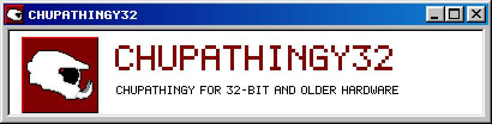

<p align="center"></p>

<p align="center">


</p>

<p align="center">
<a href="https://github.com/ChupathingyCE/chupathingy32/releases">Download</a> ·
<a href="docs/install.md">Install</a> ·
<a href="docs/troubleshooting.md">Help</a> ·
<a href="https://github.com/ChupathingyCE/chupathingyce">The game</a> ·
<a href="https://chupathingy.org">chupathingy.org</a> ·
<a href="https://discord.gg/chupathingy">Discord</a>
</p>

Chupathingy is a 64-bit game now. Chupathingy32 is where it keeps running
on everything older: 32-bit Windows, 32-bit Linux and the 2015 Steam Link.

It's the same game, from the same code. This repository holds the game as
the `chupathingyce` submodule and builds it for these machines. Each
release ships the same game commit as the matching Chupathingy release, and
plays online with every other Chupathingy build: PCs, Macs, phones and
consoles.

You need your own copy of Halo: Combat Evolved. Chupathingy32 never includes
or downloads Microsoft's files.

**Status: in testing.** The first release is planned alongside Chupathingy 0.9.2.

## Get it

Download the zip for your machine from the
[Releases page](https://github.com/ChupathingyCE/chupathingy32/releases).

| Machine | Download | Notes |
| --- | --- | --- |
| Windows, 32-bit (x86) | `chupathingyce-windows-release.zip` | Windows 10 or later. |
| Linux, 32-bit (x86) | `chupathingyce-linux-release.zip` | glibc 2.31 or later (32-bit). Brings its own SDL3. |
| Steam Link (2015) | `chupathingyce.tgz` | Not in releases yet: from the Steam Link workflow. See [docs/steam-link.md](docs/steam-link.md). |

On a 64-bit PC or a Mac, get
[Chupathingy's own builds](https://github.com/ChupathingyCE/chupathingyce/releases/latest)
instead. They run better. The 32-bit Windows build offers the 64-bit one
when it starts on 64-bit Windows.

Windows and Linux need graphics with OpenGL 3.3 or later. The Steam Link
has its own OpenGL ES 2 path.

**First start on Windows.** The builds aren't code signed yet. If Windows
warns about an unknown publisher, choose **More info**, then **Run anyway**.

## Set it up

1. Unzip the download into a folder of its own, one you can write to.
2. Start `chupathingy.exe` on Windows, or `chupathingy` on Linux.
3. Pick your Halo: Combat Evolved disc image (`.iso` or `.xiso`) from the
   original Xbox. Any region works. The game copies the maps out of it.

The Steam Link installs from a USB stick instead:
[docs/steam-link.md](docs/steam-link.md).

Each platform step by step, where your files go, and the settings:
[docs/install.md](docs/install.md).

## Updates

The game checks for a new version when it starts and asks before it
updates. Chupathingy32's builds update from this repository's releases,
signed with the same keys as the game's. Test builds and nightlies have
their own channels, as in the game.

## Play online

You play in the same online games as every other Chupathingy build. The
game's [docs](https://github.com/ChupathingyCE/chupathingyce/tree/main/docs)
cover online play, maps, modes and settings.

## Help

Ask on the [Discord](https://discord.gg/chupathingy), or file a bug in
[issues](https://github.com/ChupathingyCE/chupathingy32/issues). What's
different in the 32-bit builds, and how to send your logs:
[docs/troubleshooting.md](docs/troubleshooting.md).

## Build it yourself

You need what the game's build needs: Python 3, ninja and clang, and on
Windows Visual Studio's x86 libraries. Get the code with the game, then
build:

```sh
git clone --recursive https://github.com/ChupathingyCE/chupathingy32.git
cd chupathingy32
python3 tools/c32_build.py linux release
```

On Windows, `python tools/c32_build.py windows release`. Every step, and the
Steam Link's cross build, is in [docs/building.md](docs/building.md).

## Documentation

- [Install and play](docs/install.md): each platform, your maps, updates, `config.toml`
- [The Steam Link](docs/steam-link.md): the USB stick, button combos, performance mode
- [Help](docs/troubleshooting.md): known limits, common problems, reporting a bug
- [Building it yourself](docs/building.md): Windows, Linux and the Steam Link
- [How releases are made](docs/releases.md): versions, files, signing

## Contributing

Most changes belong in the game itself. [CONTRIBUTING.md](CONTRIBUTING.md)
says what goes where.

## Generative AI

The decompilation this project is built on, and the port it began as a fork of, were made with heavy use of generative AI. Chupathingy has its own code and releases now, but a lot of that earlier work is still in it.

We use AI tools the way developers use any other tool. A person decides what to build, reviews every change, tests it, and is responsible for it. Nothing is handed to an AI to build from start to finish without a person involved. We're also working through the code we inherited to clean up what reads as machine-written: comments that only repeat the code, unclear names, and changes nobody can explain.

If you contribute, the same applies to you: see the game's [CONTRIBUTING](https://github.com/ChupathingyCE/chupathingyce/blob/main/CONTRIBUTING.md#using-ai-tools).

## License

Chupathingy32 is free software under the GNU General Public License,
version 3 or later ([LICENSE](LICENSE)). It comes with no warranty. The game
(the `chupathingyce` submodule) is under its own repository's license, and
its third-party code under theirs. Every download carries the licenses it
needs.

The license covers Chupathingy's code only. It gives no rights in Halo or
anything else Microsoft owns.

## Support

Chupathingy is free and always will be. Support through
[Ko-fi](https://ko-fi.com/milenko) or [Patreon](https://www.patreon.com/c/chupathingy)
goes to running the site and the servers. To support a specific developer
or port, ask them directly.

## Credits

- [JizzyRivers](https://github.com/JizzyRivers): the Steam Link port
  (`port/steamlink`, with its history), and the game's ARM, OpenGL ES 2 and
  older-hardware hooks it builds on. Thank you.
- The game: [Chupathingy](https://github.com/ChupathingyCE/chupathingyce)
  by [Milenko](https://github.com/MrMilenko) and contributors. Its README
  credits everyone whose work is in it.
- The icon: the game's helmet with tusks (MrBruh's, from OpenCE), drawn
  again as Windows 9x pixel art. The pictures on this page are made from it
  by `tools/c32_readme_art.py`.
- Valve's [Steam Link SDK](https://github.com/ValveSoftware/steamlink-sdk),
  which the Steam Link build downloads. It isn't part of this repository.
- The Khronos Group's OpenGL ES headers (`port/steamlink/include`, MIT and
  Apache-2.0).
- Mozilla's certificate list, as packaged by curl
  (`port/steamlink/app/ca-certificates.crt`).

## Where it came from

Chupathingy is a port of the Halo: Combat Evolved decompilation
([punpckhdq/halo](https://github.com/punpckhdq/halo) and
[bnunu/halo-1](https://github.com/bnunu/halo-1), of the Xbox build 2342).
It began as a fork of OpenCE, an earlier port of that decompilation (the
code is theirs up to October 9, 2026), and has had its own code, releases
and community since. Chupathingy32 builds that game for 32-bit and older
hardware.

<p align="center"></p>

<sub>Chupathingy32 is an unofficial fan project. It isn't affiliated with or endorsed by Microsoft, Xbox Game Studios, Bungie, Halo Studios or Valve. Halo is a trademark of Microsoft. Steam Link is a trademark of Valve. No game files are included: you bring your own copy. The code is released under the GNU GPL, version 3 or later (see [License](#license)).</sub>
